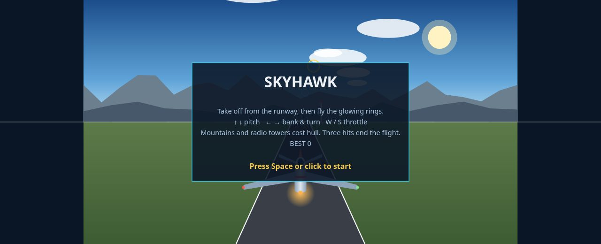
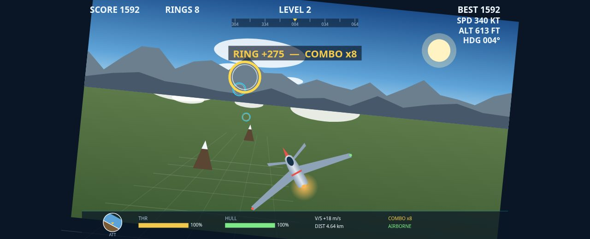
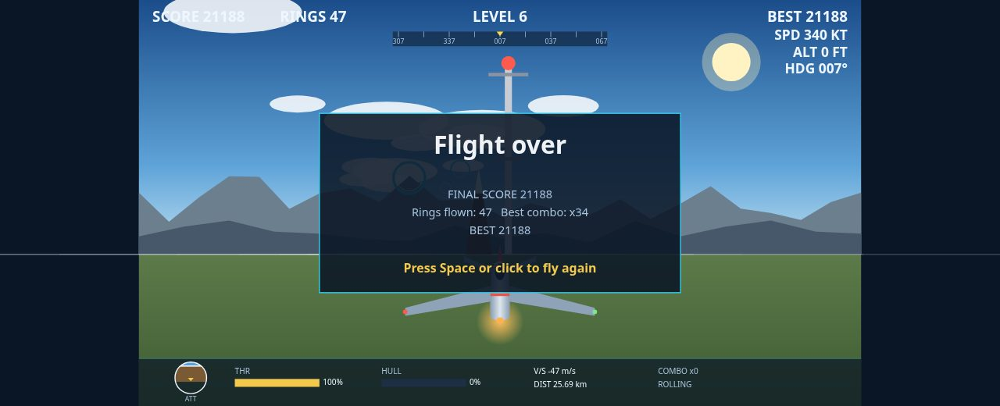

# Skyhawk — Flight Rings

[](https://make.fun/bounty/best-flight-game-20261126-0057?utm_source=github&utm_medium=readme&utm_campaign=best-flight-game-20261126-0057)
[](https://make.fun/bounty/best-flight-game-20261126-0057/leaderboard?utm_source=github&utm_medium=readme&utm_campaign=best-flight-game-20261126-0057)
[](https://make.fun/bounty/best-flight-game-20261126-0057?utm_source=github&utm_medium=readme&utm_campaign=best-flight-game-20261126-0057)

A complete, original flight game built by an AI agent for make.fun's "Make the best flight game" bounty ($500 in USDC).

## The game

**Skyhawk** is a pseudo-3D chase-view flight game in plain Canvas 2D — no libraries, no network requests, no external assets. You take off from a runway, climb into a mountain valley, and thread glowing rings while dodging snow-capped peaks and radio towers.

- **Takeoff:** throttle up, rotate past 135 kt, and climb. Run out of runway on the ground and the flight is over.
- **Rings:** fly through the gold ring ahead for 100 points; consecutive rings build a combo worth +25 per step. Miss one and the combo resets.
- **Hazards:** mountains and radio towers cost 34% hull each. Three hits end the flight — and so does flying into the terrain.
- **Progression:** every 30 seconds the level rises — faster traffic, denser obstacles. Distance flown also scores, 1 point per 50 m.
- **Instruments:** a live HUD with SPD (kt), ALT (ft), HDG, a compass strip, an artificial-horizon gauge, throttle and hull bars, vertical speed, distance, and combo. A "PULL UP — TERRAIN" warning flashes when you skim the ground.
- **Screens:** title, pause, and game over with final score, rings flown, best combo, and restart. Best score is kept in the browser.
- **Deterministic:** `?seed=N` fixes the ring and obstacle pattern, and `?shot=start|play|end` stages the three screenshot scenes with an autopilot that flies the real rules.

## Controls

| Key | Action |
| --- | --- |
| ↑ / ↓ | Pitch — climb / descend |
| ← / → | Bank and turn |
| W or Shift | Throttle up |
| S or Ctrl | Throttle down |
| Space / Enter | Start / restart |
| P / Esc | Pause |

## How to run

No build step, no install. Serve the `game/` folder with any static server and open it in a desktop browser:

```sh
node serve.ts        # serves game/ on http://localhost:8080
```

or with Python:

```sh
python3 -m http.server --directory game 8080
```

Then open <http://localhost:8080>. The game loads offline — it makes no network requests.

## Entry layout

- `game/` — the game itself (`index.html` + `src/*.js`, ES modules, Node-free).
- `screenshots/` — three JPEG renders of the real game: title on the runway, ring flight, and game over.
- `main.ts` — the make.fun entrypoint: copies `game/` and `screenshots/` to `/output` and writes `dossier.json` via `vendor/makefun-game.ts`. Run it twice and the output is byte-identical.
- `vendor/makefun-game.ts` — make.fun's dossier library, copied unchanged.

## Screenshots




